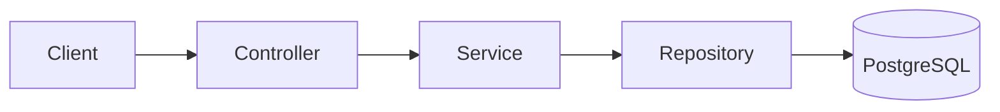

<h1 align="center">Task Manager API</h1>

<p align="center">
  A REST API to create, read, update and delete tasks.<br>
  Built with Java, Spring Boot and PostgreSQL.
</p>

<p align="center">
  
  
  
  
</p>

> **Learning project.** I built this API to practice Spring Boot, layered architecture and working with a relational database. It is under active development. See the [roadmap](#roadmap) for what comes next.

---

## Features

- Full **CRUD** for tasks: create, list, get one, update, delete
- **UUID** identifiers for every task
- Persistence with **Spring Data JPA** and **PostgreSQL**
- Correct **HTTP status codes** (`201 Created`, `204 No Content`, `404 Not Found`)
- Clean **layered structure**: controller, service, repository

## Tech stack

| Layer | Technology |
|---|---|
| Language | Java |
| Framework | Spring Boot (Spring Web, Spring Data JPA) |
| Database | PostgreSQL |
| Boilerplate reduction | Lombok |

## Architecture



- **Controller** receives the HTTP request and returns the response.
- **Service** contains the business logic and decides what happens when a task is not found.
- **Repository** talks to the database through Spring Data JPA.

The controller depends on a service **interface**, and dependencies are injected through the constructor.

## API endpoints

Base path: `/tasks`

| Method | Endpoint | Description | Success | Error |
|---|---|---|---|---|
| `GET` | `/tasks` | List all tasks | `200 OK` | |
| `GET` | `/tasks/{taskId}` | Get one task | `200 OK` | `404` if not found |
| `POST` | `/tasks` | Create a task | `201 Created` | |
| `PUT` | `/tasks/{taskId}` | Update title and description | `200 OK` | `404` if not found |
| `DELETE` | `/tasks/{taskId}` | Delete a task | `204 No Content` | `404` if not found |

### The task object

| Field | Type | Description |
|---|---|---|
| `id` | UUID | Generated by the database layer, not sent by the client |
| `title` | String | Title of the task |
| `description` | String | Description of the task |

### Example requests

Create a task:

```bash
curl -X POST http://localhost:8080/tasks \
  -H "Content-Type: application/json" \
  -d '{"title": "Learn Spring Boot", "description": "Finish the task manager API"}'
```

Response (`201 Created`):

```json
{
  "id": "3f2b8c1e-5a4d-4e0a-9d7b-1c2e3f4a5b6c",
  "title": "Learn Spring Boot",
  "description": "Finish the task manager API"
}
```

List all tasks:

```bash
curl http://localhost:8080/tasks
```

Update a task:

```bash
curl -X PUT http://localhost:8080/tasks/<task-id> \
  -H "Content-Type: application/json" \
  -d '{"title": "Learn Spring Boot", "description": "Add validation and tests"}'
```

Delete a task:

```bash
curl -X DELETE http://localhost:8080/tasks/<task-id>
```

## Getting started

### Requirements

- JDK 27
- PostgreSQL
- Maven 

### Run locally

1. Clone the repository:

   ```bash
   git clone https://github.com/yahiamana/task-manager-api.git
   cd task-manager-api
   ```

2. Create a PostgreSQL database:

   ```sql
   CREATE DATABASE taskmanager;
   ```

3. Copy `src/main/resources/application-example.properties` to `src/main/resources/application.properties` and enter your own database user and password:

   ```properties
   spring.datasource.url=jdbc:postgresql://localhost:5432/task_manager
   spring.datasource.username=your_username
   spring.datasource.password=your_password
   spring.jpa.hibernate.ddl-auto=update
   ```

4. Start the application:

   ```bash
   ./mvnw spring-boot:run
   ```

5. The API is now available at `http://localhost:8080/tasks`.

## Project structure

```
src/main/java/com/taskmanager/taskmanager
├── controllers    REST controller (HTTP layer)
├── abstracts      Service interface
├── services       Service implementation (business logic)
├── repository     Spring Data JPA repository
└── entities       JPA entity
```

## What I learned

- How a request travels through the layers of a Spring Boot application
- Constructor-based dependency injection and programming against an interface
- Mapping a Java class to a database table with JPA and using UUID identifiers
- Choosing the right HTTP status codes for a REST API
- Handling a missing resource with a `404` response

## Roadmap

This is the first version. Next improvements:

- [ ] Input validation with Bean Validation (`@NotBlank`) and clear `400` error messages
- [ ] Separate request and response objects (DTOs) so clients cannot set the `id`
- [ ] Global exception handling with `@RestControllerAdvice`
- [ ] Task `status` (open, in progress, done) and `dueDate`, plus filtering by status
- [ ] Unit and integration tests (JUnit, Mockito, MockMvc)
- [ ] API documentation with OpenAPI / Swagger
- [ ] Docker Compose setup for the app and PostgreSQL

## Author

**Yahia Mana**
[LinkedIn](https://www.linkedin.com/in/manayahia/) · [GitHub](https://github.com/yahiamana) · yahiamana4@gmail.com
